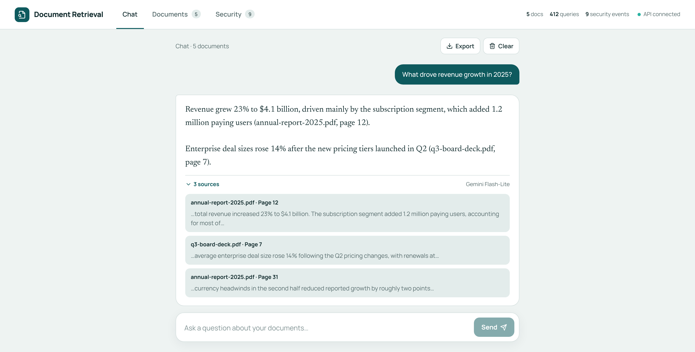

# Document Retrieval System

Ask questions about your PDFs and get answers that cite the exact page they came from. This project combines a **Retrieval-Augmented Generation (RAG)** pipeline built on Google Gemini, LangChain and Chroma with a FastAPI backend, a React dashboard, and a security layer that screens every query and response for PII, prompt injection and leaked secrets.



---

## Table of Contents

- [Overview](#overview)
- [Features](#features)
- [Architecture](#architecture)
- [Tech Stack](#tech-stack)
- [Getting Started](#getting-started)
  - [Prerequisites](#prerequisites)
  - [Local Development](#local-development)
  - [Docker Deployment](#docker-deployment)
- [Configuration](#configuration)
- [API Reference](#api-reference)
- [Security](#security)
- [Testing](#testing)
- [Project Structure](#project-structure)
- [Troubleshooting](#troubleshooting)

---

## Overview

Reading through long PDFs to find one answer is slow. Document Retrieval System indexes your documents once and lets you query them in plain English. Every answer is grounded in retrieved passages and shows the document name and page number, so you can verify it yourself.

**How a question gets answered:**

| Step | What happens |
|------|--------------|
| 1. Ingest | Uploaded PDFs are parsed and split into **semantic chunks**: sentences are embedded and cut where the topic shifts, with a recursive-character splitter as fallback |
| 2. Index | Chunks are embedded (Gemini embeddings, or an offline sentence-transformers model) and stored in **Chroma** |
| 3. Retrieve | The question is embedded and the most similar chunks are pulled from the vector store |
| 4. Generate | **Gemini Flash-Lite** writes an answer using only the retrieved context, with page-level citations |

Follow-up questions work because the conversation history is sent with each query. Conversations can be exported as Markdown from the chat view.

---

## Features

### Core
- **PDF Upload & Management** — Upload, list, and delete documents via a clean web UI
- **Semantic Chunking** — Documents are split at embedding-distance topic shifts rather than fixed-size windows, so each chunk stays on one idea (`services/document_processor.py`)
- **Semantic Search** — Vector similarity search over document chunks using Chroma
- **RAG-Powered Q&A** — Contextual answers from Google Gemini, grounded in your documents
- **Source Attribution** — Every answer links back to the source document and page number
- **Conversation Memory** — Multi-turn conversations with maintained chat history
- **Chat Export** — Download any conversation, with its sources, as a Markdown file
- **Gemini or Local Embeddings** — Gemini embeddings by default, or an offline sentence-transformers model with `EMBEDDING_MODEL=local`. Each model keeps its own index, rebuilt from your PDFs at startup, so switching models never mixes their vectors

### Security
- **PII Detection** — Identifies emails, phone numbers, SSNs, and credit card numbers using Microsoft Presidio (with regex fallback)
- **Injection Prevention** — Detects and blocks prompt-injection attempts in user input
- **Output Content Filtering** — Redacts API keys, passwords, and tokens from LLM responses before they reach the user
- **Security Audit Logging** — All security incidents are logged with timestamps for review
- **Security Dashboard** — Real-time monitoring UI showing incident counts, PII detections, and recent events

### Developer Experience
- **Auto-generated API Docs** — Swagger UI at `/docs` and ReDoc at `/redoc`
- **Docker Support** — One-command deployment with Docker Compose
- **Makefile Shortcuts** — Common tasks available as `make` commands
- **Test Suite** — Pytest suite run in CI on every push

---

## Architecture

```
┌─────────────────────────────────────────────────────────┐
│                    Frontend (React + Vite)               │
│  ┌──────────────┐  ┌──────────────┐  ┌───────────────┐  │
│  │ DocumentUpload│  │ChatInterface │  │SecurityDashbrd│  │
│  └──────┬───────┘  └──────┬───────┘  └───────┬───────┘  │
└─────────┼─────────────────┼──────────────────┼──────────┘
          │                 │                  │  HTTP/REST
          ▼                 ▼                  ▼
┌─────────────────────────────────────────────────────────┐
│                  Backend (FastAPI)                       │
│                                                         │
│  ┌────────────────────────────────────────────────────┐ │
│  │                Security Layer                      │ │
│  │  PII Detector │ Input Validator │ Content Filter   │ │
│  └────────────────────────────────────────────────────┘ │
│                          │                              │
│  ┌───────────────────────┼───────────────────────────┐  │
│  │              RAG Agent (LangChain)                │  │
│  │                       │                           │  │
│  │  ┌────────────────────┴─────────────────────┐    │  │
│  │  │         Document Processor               │    │  │
│  │  │  PDF Parsing → Chunking → Embedding      │    │  │
│  │  └────────────────────┬─────────────────────┘    │  │
│  │                       │                           │  │
│  │  ┌────────────────────┴─────────────────────┐    │  │
│  │  │           Vector Store (Chroma)          │    │  │
│  │  │  Persist & Retrieve Semantic Embeddings  │    │  │
│  │  └──────────────────────────────────────────┘    │  │
│  └───────────────────────────────────────────────────┘  │
│                          │                              │
│              Google Gemini API                          │
│         (Embeddings + Text Generation)                  │
└─────────────────────────────────────────────────────────┘
```

### Data Flow

1. **Upload**: User uploads a PDF → FastAPI saves it → `DocumentProcessor` parses and chunks the text → chunks embedded via Gemini → stored in Chroma
2. **Query**: User sends a question → Security layer validates input → RAG agent retrieves top-k relevant chunks → Gemini generates answer with source citations → Content filter scans output → Response returned to UI

---

## Tech Stack

| Layer | Technology |
|---|---|
| Frontend | React 18, Vite, Lucide React |
| Backend | Python 3.9+, FastAPI, Uvicorn |
| LLM | Google Gemini Flash-Lite, via the `gemini-flash-lite-latest` alias (`langchain-google-genai`) |
| Embeddings | Gemini `gemini-embedding-001`, or local `all-MiniLM-L6-v2` (sentence-transformers) |
| Vector Store | ChromaDB 0.4 |
| LLM Orchestration | LangChain 0.1 |
| PDF Parsing | PyPDF 4.0 |
| PII Detection | Microsoft Presidio (spaCy `en_core_web_sm`) |
| Data Validation | Pydantic |
| Testing | pytest, pytest-cov |
| Containerization | Docker, Docker Compose |

---

## Getting Started

### Prerequisites

- **Python** 3.9 or higher
- **Node.js** 18 or higher
- **Google Gemini API Key** — Get one free at [aistudio.google.com](https://aistudio.google.com/app/apikey)

### Local Development

**1. Clone the repository**

```bash
git clone https://github.com/arnavjot/document-retrieval-system.git
cd document-retrieval-system
```

**2. Install**

This creates a Python virtual environment, installs all backend and frontend dependencies, downloads the required spaCy NLP model, and copies `.env.example` to `backend/.env`.

```bash
make setup
```

**3. Configure your API key**

Open `backend/.env` and set `GEMINI_API_KEY=your_key_here`.

**4. Start the application**

```bash
make start   # Ctrl+C stops both servers
```

The application will be available at:

| Service | URL |
|---|---|
| Frontend | http://localhost:5173 |
| Backend API | http://localhost:8000 |
| Swagger Docs | http://localhost:8000/docs |
| ReDoc | http://localhost:8000/redoc |

### Docker Deployment

```bash
make docker-start   # first run creates .env from .env.example; set GEMINI_API_KEY there and rerun
make docker-stop
```

### Makefile Commands

```bash
make setup        # Create the venv, install dependencies, create backend/.env
make start        # Start backend and frontend locally
make stop         # Stop local servers listening on 8000 / 5173
make test         # Run the backend test suite
make eval         # Run the retrieval & grounding eval
make clean        # Remove venvs, caches and local data
make docker-start # Start with Docker Compose
make docker-stop  # Stop Docker containers
```

---

## Configuration

All configuration is managed via environment variables. Copy `.env.example` to `backend/.env` and adjust as needed.

| Variable | Default | Description |
|---|---|---|
| `GEMINI_API_KEY` | *(required)* | Your Google Gemini API key |
| `EMBEDDING_MODEL` | Gemini `models/gemini-embedding-001` if `GEMINI_API_KEY` is set, otherwise `local` | `local` for the offline sentence-transformers model, or a Gemini embedding model name. Read once at startup (the answer-generating model is `CHAT_MODEL` in `rag_agent.py`) |
| `CHROMA_PERSIST_DIRECTORY` | `./data/vectorstore` | Path to persist the Chroma vector DB (relative to `backend/`) |
| `ANONYMIZED_TELEMETRY` | `False` | Chroma anonymized telemetry (off unless set to `True`) |

**Choosing the embedding model.** The embedding model is fixed for the life of the process, because vectors from different models can't share an index (Gemini's are 3072-dimensional, the local model's 384). Each model gets its own Chroma collection (`documents-<model>`), and at startup the app reconciles that collection with the PDFs in `backend/data/documents`: files it hasn't indexed yet are embedded, and chunks of files deleted since are dropped. Switching models is therefore just a restart; the first start on a model embeds your existing library once. `GET /api/health` reports which model is active.

---

## API Reference

### Document Management

| Method | Endpoint | Description |
|---|---|---|
| `POST` | `/api/upload` | Upload a PDF document |
| `GET` | `/api/documents` | List all uploaded documents |
| `DELETE` | `/api/documents/{filename}` | Delete a document and its embeddings |

### Query & Chat

| Method | Endpoint | Description |
|---|---|---|
| `POST` | `/api/query` | Submit a question (with security checks) |
| `GET` | `/api/stats` | Get system statistics (docs, queries, incidents) |
| `GET` | `/api/health` | Health check endpoint |

### Security & Administration

| Method | Endpoint | Description |
|---|---|---|
| `GET` | `/api/security/logs` | Retrieve security incident logs (last 50 by default) |

#### Query Request Body

```json
{
  "question": "And how is it calculated?",
  "conversation_history": [
    { "role": "user", "content": "What is the main topic of the document?" },
    { "role": "assistant", "content": "The document covers..." }
  ]
}
```

`conversation_history` is optional; the backend keeps no session state.

#### Query Response

```json
{
  "answer": "It is calculated as... (report.pdf, page 3)",
  "sources": [
    { "content": "First 200 characters of the chunk...", "page": 3, "source": "report.pdf" }
  ],
  "security_warnings": []
}
```

Full interactive API documentation is available at `/docs` when the backend is running.

---

## Security

This application implements a multi-layer security architecture to protect both users and the system.

### Input Validation

All user queries pass through `InputValidator` before reaching the LLM:
- **Prompt Injection** — Detects attempts to override system instructions (e.g., "ignore previous instructions"), in the question and in the earlier user turns the client sends back as history (flagged turns are dropped from the history)

Flagged queries are blocked and logged before any LLM processing occurs.

### Instruction Hierarchy

The RAG prompt enforces an explicit instruction hierarchy: the system rules sit above the retrieved document context and the user question, both of which are wrapped in delimiters and treated as untrusted **data**, never as instructions. Injection-style text embedded in a document or question is to be reported, not obeyed — the in-prompt complement to the regex gate above (`agents/prompt_templates.py`).

### PII Redaction

Detected PII is redacted (`security/pii_detector.py`) before the query is written to the audit log or forwarded to Gemini, so raw PII never leaves the process. That includes blocked injection attempts, which are logged redacted.

### PII Detection

The `PIIDetector` scans both user inputs and LLM outputs for:
- Email addresses
- Phone numbers
- Social Security Numbers
- Credit card numbers

Detection uses Microsoft Presidio (with spaCy NER) when available, with a regex-based fallback. Detections are flagged in the response and logged as security incidents.

### Output Content Filtering

`ContentFilter` scans LLM responses and redacts any accidental exposure of:
- API keys and tokens
- Passwords and credentials
- Private keys

### Security Dashboard

The frontend Security Dashboard provides:
- Total incident count and PII detection count
- A security score and the flags raised on each event
- Timestamped log of recent security events

### Security Logging

All security incidents are appended to `backend/data/logs/security_log.jsonl`, one JSON object per line, with the query already redacted:

```json
{
  "timestamp": "2026-01-15T10:30:00",
  "query": "Who is [REDACTED]?",
  "flags": ["PII_DETECTED"],
  "pii_detected": true
}
```

---

## Testing

```bash
make test
# or: cd backend && venv/bin/python -m pytest
```

This runs all tests under `backend/tests/`, the same command CI runs.

### Retrieval & Grounding Evaluation

Beyond unit tests, an evaluation harness (`backend/eval/`) scores the embedding model and the RAG prompt against a labelled gold set:

```bash
make eval
# or: cd backend && python -m eval.run_eval --k 4 --threshold 0.7
```

It reports **context relevance** (does retrieval surface the passage that holds the answer?) and **grounded-response rate** (are answerable questions answered from context, and are out-of-scope questions correctly abstained on?). It embeds with the app's configured model, so with no `GEMINI_API_KEY` (or with `EMBEDDING_MODEL=local`) it runs fully offline, and it exits non-zero below a threshold. Add `--generate` with a valid `GEMINI_API_KEY` to score answer faithfulness on the model's real responses.

Scope, so the numbers aren't over-read: the corpus is ten pre-split, single-topic passages from a fictional handbook, retrieved by a small in-memory cosine search. It does not exercise PDF parsing, the semantic chunker, Chroma, or the conversational chain. Without `--generate`, out-of-scope questions count as handled when the best match scores below `--abstain-threshold`; the app itself has no such cutoff and leaves abstaining to the prompt.

---

## Project Structure

```
document-retrieval-system/
├── backend/
│   ├── agents/
│   │   ├── rag_agent.py           # Core RAG pipeline (retrieval + generation)
│   │   └── prompt_templates.py    # System and user prompt templates
│   ├── services/
│   │   ├── document_processor.py  # PDF parsing and text chunking
│   │   ├── vectorstore.py         # Chroma vector DB wrapper
│   │   └── embeddings.py          # Picks the Gemini or local embedding model
│   ├── security/
│   │   ├── pii_detector.py        # PII detection (Presidio + regex)
│   │   ├── input_validator.py     # Prompt-injection detection
│   │   └── content_filter.py      # Output sensitive data redaction
│   ├── tests/                     # pytest test suite
│   ├── data/                      # Created at runtime, gitignored; Docker mounts the same folder
│   │   ├── documents/             # Uploaded PDFs
│   │   ├── vectorstore/           # Chroma vector database, one collection per embedding model
│   │   └── logs/                  # Security event log
│   ├── app.py                     # FastAPI application and route definitions
│   └── requirements.txt
│
├── frontend/
│   ├── src/
│   │   ├── App.jsx                # Root component with tab navigation
│   │   ├── components/
│   │   │   ├── ChatInterface.jsx  # Q&A chat UI
│   │   │   ├── DocumentUpload.jsx # Upload and document list management
│   │   │   ├── MessageBubble.jsx  # Individual chat message rendering
│   │   │   └── SecurityDashboard.jsx # Security metrics and incident log
│   │   └── services/
│   │       └── api.js             # fetch helper for all backend calls
│   ├── package.json
│   └── vite.config.js
│
├── docker-compose.yml
├── Makefile
└── .env.example
```

---

## Troubleshooting

**Gemini API quota exceeded**

Gemini calls fail until the quota resets: an upload returns the error, and a question gets an error answer. The app does not silently switch embedding models mid-run, because the local model's vectors can't be searched against an index built with Gemini's. To keep indexing and retrieving without Gemini embeddings, set `EMBEDDING_MODEL=local` in `backend/.env` and restart; your PDFs are embedded into the local model's own index at startup. Switch back the same way; the Gemini index is still there and catches up on anything uploaded in between. Answers are still generated by Gemini, so the chat model needs quota either way.

**spaCy model not found**

If PII detection fails with a model error, run:
```bash
python -m spacy download en_core_web_sm
```

**Chroma version conflicts**

This project pins `chromadb==0.4.22`. Do not upgrade without testing, as the Chroma API changed significantly in 0.5+.

**Port already in use**

Check for existing processes on ports 8000 (backend) and 5173 (frontend):
```bash
lsof -i :8000
lsof -i :5173
```

**Docker: environment variables not picked up**

Ensure your `.env` file is in the project root (not `backend/.env`) when running Docker Compose, as `docker-compose.yml` reads from the project root.
